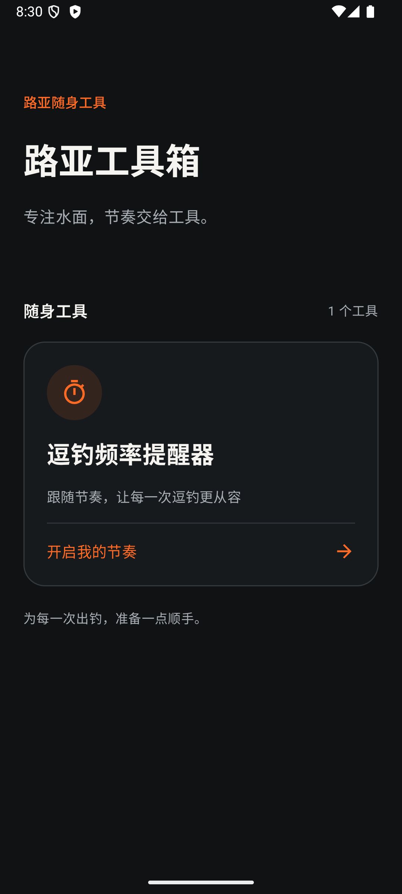
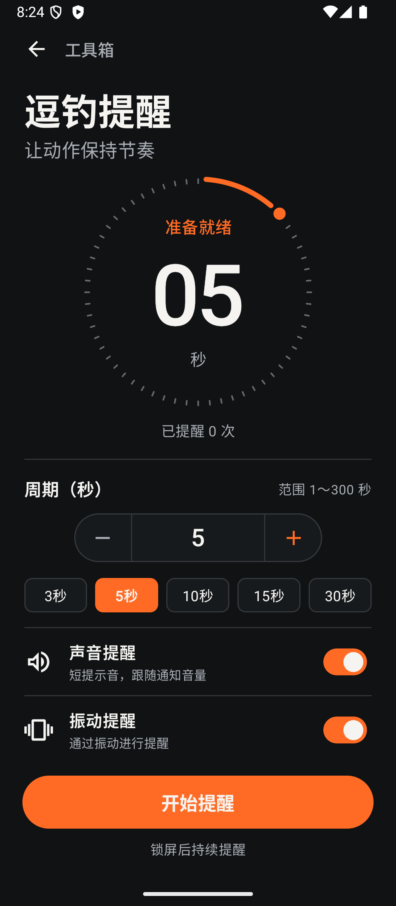

# 路亚工具箱 · Android 1.1.6

一个面向路亚钓鱼的安卓工具合集，目前提供逗钓频率提醒器。原生 Kotlin / Jetpack Compose 开发，支持 Android 8.0 及以上，无账号、网络、广告或分析 SDK。

[下载 Android 1.1.6 调试安装包](https://github.com/KamiOrz/lure-toolbox/releases/download/v1.1.6/lure-toolbox-1.1.6-debug.apk) · [验证记录](VALIDATION.md) · [MIT 许可证](LICENSE)

<p>
  
  
</p>

## 功能

- 1～300 秒整数周期，支持常用周期快捷选择。
- 声音、振动独立控制，媒体音量滑块与试听。
- 倒计时、提醒次数、暂停、继续、结束。
- 前台服务与通知控制，支持锁屏与切换应用后提醒。
- 自动保存设置，重新打开不会自动开始。

## 安装与使用

调试安装包：`releases/lure-toolbox-1.1.6-debug.apk`（或构建目录 `app/build/outputs/apk/debug/app-debug.apk`）。

1.1 采用确认后的黑橙设计：圆形刻度计时盘、白色大数字、胶囊周期输入、独立快捷选项、两行提醒开关和固定底部按钮。工具首页使用同一套配色。

1. 安装并打开「路亚工具箱」，选择「逗钓频率提醒器」。
2. 输入 1～300 的整数秒、使用加减按钮或选择快捷周期，至少开启声音、振动中的一种。
3. 点击「开始提醒」，首次经过完整周期提醒。通知权限即使被拒绝也可开始，但通知栏控制可能不可见。
4. 暂停保留剩余时间，继续后接着计时；结束清零次数。运行与暂停期间设置锁定。
5. 返回首页、锁屏或切换应用后继续运行，通过常驻通知或应用控制。强制停止、进程终止或重启不会自动恢复。

声音提醒旁的「音量」可打开滑块与试听面板，音量和手机媒体音量同步。App 主界面及音量面板内的侧面按键直接调节媒体音量；静音不播放声音，振动模式仍可振动；勿扰期间不触发声音和振动。没有振动器的设备无法提供触觉提醒。底部「锁屏后台设置」可打开后台运行说明与系统设置。小米/红米需检查应用省电策略是否为「无限制」；前台服务仍可能被厂商限制唤醒锁，需按实际设备验证。

## 构建

使用 JDK 17 或更新的兼容 JDK（本机验证使用 Android Studio 自带 JBR），Android SDK 36。

```sh
./gradlew assembleDebug testDebugUnitTest lintDebug
```

Android Studio 打开项目可自动配置本机 SDK；命令行可在未跟踪的 `local.properties` 中设置 `sdk.dir`。

## 结构

- `MainActivity`：Compose 导航、统一工具入口列表及两页界面。
- `SettingsViewModel`：DataStore 设置与读写状态。
- `ReminderService`：唯一运行状态源、前台通知、声音、振动、唤醒锁。
- `TimerEngine`：纯 Kotlin 单调时钟状态机；不累积周期漂移，延迟不补发多次提醒。

服务使用 Android 的 `specialUse` 前台服务类型，声音开启时同时声明 `mediaPlayback` 后台音频播放类型，声明用途为用户主动开始的持续钓鱼节奏提示。公开商店发布前需完成对应服务用途声明与审核。唤醒锁仅在运行期间持有，暂停和结束释放。无开机广播、自动重启或精确闹钟权限。

## 验证

自动测试覆盖首次提醒、暂停继续、跳过延迟周期、周期边界、结束重开。实际构建、Lint 与模拟器结果见 `VALIDATION.md`。

已在连接的 Android 16 真机完成安装与基础计时、暂停、继续、结束检查。声音/振动的实际感知、厂商省电策略和锁屏连续运行 30 分钟仍需进一步验收。

提示音为项目内合成的 1300/1800Hz 增强双音，双音持续约 0.455 秒，另有 0.100 秒音频设备预热静音；保留淡入淡出且不削波，无第三方音频授权依赖。可通过 `python3 scripts/generate_reminder_sound.py` 重建。

## 设计与资源

选定设计保存在 `docs/design/reminder-target.png`；实际原生界面对比和验收见 `design-qa.md`。字体使用安卓系统无衬线字体，图标来源及许可见 `THIRD_PARTY_NOTICES.md`。升级保留原有 DataStore 设置，无需迁移。

1.1.1 新增橙色鱼形路亚自适应桌面图标，原图、提示概要和安卓渲染预览位于 `docs/icon/`。

1.1.2 使用确认后的「工具箱＋路亚假饵」图标，并已覆盖安装到连接的手机；保留原设置。

1.1.3 增强双提示音，音源 RMS 较旧版增加约 5.2 dB；App 内音量键指向通知音量通道。不会自动设置手机的全局音量，仍遵循静音与勿扰设置。

1.1.4 修复真机音量控制：提示音与试听共用媒体通道，主界面和音量对话框直接处理音量键；音量面板实时读取系统音量，滑块调节后回读实际值，可在计时过程中使用。零音量、静音和勿扰会给出试听提示。新增普通权限 `MODIFY_AUDIO_SETTINGS` 用于用户主动调节媒体音量，首次打开不自动改动音量。

1.1.5 为每次短提示申请临时可压低媒体的音频焦点（1.1.6 改为播放完成后释放），解决其他视频 App 播放时提醒声被压制的问题。暂停、结束或焦点被系统收回时立即停止声音并释放焦点；不排队补放错过的提示。已在真机与抖音同时播放场景验证。


1.1.6 改用 MediaPlayer 播放完成回调，取消固定时长截断；增加媒体播放前台服务类型和锁屏后台设置入口。在测试设备将省电策略设为「无限制」后，通过两分钟锁屏连续提醒检查。

## 参与开发

欢迎通过 Issue 反馈设备型号、安卓版本、复现步骤和预期表现，也欢迎提交工具建议与 Pull Request。不要在反馈中附带密码、签名密钥或个人数据。

## 许可证

项目代码采用 [MIT License](LICENSE)。Material 图标等第三方资源保留原有许可，详见 [THIRD_PARTY_NOTICES.md](THIRD_PARTY_NOTICES.md)。
